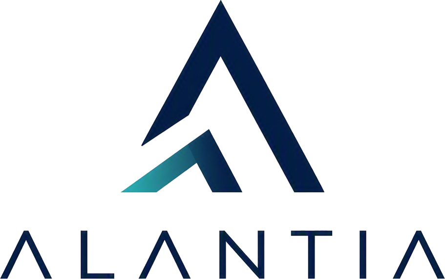

<p align="left"></p>

# Harness Engineering — Alantia

Aprende a construir agentes de programación confiables. Un curso en español para diseñar el contexto, las herramientas, el estado y la verificación que permiten convertir la capacidad de un modelo en resultados comprobables.

**14 lecciones · 8 proyectos · Plantillas y ejemplos · Español**

Esta edición adapta [Learn Harness Engineering, de WalkingLab](https://github.com/walkinglabs/learn-harness-engineering), con la identidad visual de [Alantia.ai](https://alantia.ai/). Conserva el historial y la licencia MIT del proyecto original.

## Empieza aquí

- [Primera lección: un modelo potente no garantiza una ejecución confiable](docs/es/lectures/lecture-01-why-capable-agents-still-fail/index.md)
- [Proyectos prácticos](docs/es/projects/index.md)
- [Plantillas listas para usar](docs/es/resources/templates/index.md)
- [Análisis de Pi, Claude Code, Codex y DeepSeek](docs/es/harness-designs/index.md)
- [Glosario y criterio de traducción](docs/es/glosario.md)

## Ruta de aprendizaje

| Etapa | Lecciones | Lo que aprenderás |
| --- | --- | --- |
| Bases del harness | 01–04 | Diseñar instrucciones y organizar el repositorio como fuente de verdad. |
| Continuidad y alcance | 05–08 | Conservar estado, inicializar el entorno y delimitar tareas. |
| Verificación y observabilidad | 09–12 | Exigir evidencia y dejar cada sesión lista para continuar. |
| Autonomía y coordinación | 13–14 | Diseñar ciclos automáticos y flujos de trabajo como grafos. |

Los proyectos 01–06 evolucionan una aplicación de escritorio con Electron, TypeScript y React. Incluyen `starter/` y `solution/`. Los proyectos 07–08 son guías prácticas para diseñar ciclos y grafos; no incluyen aplicaciones de referencia independientes.

## Ejecutar el curso localmente

Requisitos: Node.js 24, npm y Git.

```bash
git clone https://github.com/AIMM-dev/alantia-harness-engineering.git
cd alantia-harness-engineering
npm ci
npm run docs:dev
```

Abre la dirección que indica VitePress. La ruta base predeterminada es `/alantia-harness-engineering/`.

```bash
npm run anchors:build  # Actualiza el mapa tras editar encabezados
npm run anchors:check  # Verifica los enlaces a secciones
npm run docs:build     # Compila y comprueba los enlaces internos
npm run docs:preview   # Sirve la versión compilada
```

Para servir desde la raíz de un dominio, define `DOCS_BASE_PATH=/`. En PowerShell: `$env:DOCS_BASE_PATH='/'` antes de compilar.

## Publicación opcional en GitHub Pages

El repositorio incluye un flujo manual en **Actions → Publicar curso en GitHub Pages**. Primero configura **Settings → Pages → Source: GitHub Actions**. El flujo toma automáticamente el nombre del repositorio para resolver los recursos. Guardar el código no activa la publicación del sitio.

La integración continua comprueba los encabezados y la compilación en cada push o pull request. Los scripts de exportación de PDF y capturas se conservan y apuntan a la edición española; requieren Chromium de Playwright.

## Qué incluye esta adaptación

- Portada, logotipos oficiales, Montserrat e Inter autoalojadas y colores del manual de marca de Alantia.
- Tema claro y oscuro, diseño adaptable, navegación por teclado y movimiento reducido.
- Español como idioma de entrada, navegación, búsqueda y controles.
- Revisión de anglicismos, glosario y plantillas de la lección 13 traducidas.
- Corrección de enlaces internos heredados y verificación de enlaces activa.
- Los otros idiomas se conservan en el repositorio como referencia, pero no se publican ni se incluyen en la búsqueda de esta edición.

Los identificadores, rutas, comandos y ejemplos de código conservan su forma técnica para no romper su ejecución. Las aplicaciones de práctica se mantienen como material original del curso.

## Créditos

Contenido original: **WalkingLab y colaboradores**, licencia [MIT](LICENSE). Adaptación visual y editorial: **Alantia.ai**. Consulta [ATTRIBUTION.md](ATTRIBUTION.md) para las fuentes de marca y tipografías. La identidad de Alantia.ai no queda relicenciada bajo MIT.
